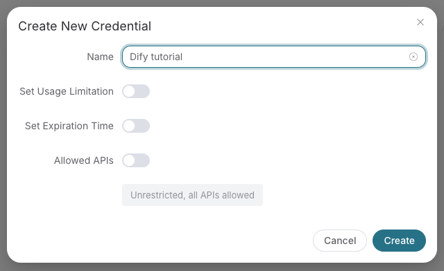

# GPT Image by Ace Data Cloud — Qwen Code extension

Generate and edit GPT Image pictures through Ace Data Cloud, and retrieve the original async task. This independent native extension runs the **existing dedicated GPT Image stdio profile** from the published `mcp-openai-pro==2026.10.19.5` package. It installs no other service and adds no LLM provider.

**Source prerelease `0.1.0-rc.2`.** RC1 used the general hosted OpenAI endpoint and four older tools. RC2 replaces that configuration with the published five-tool profile; it does not create a server or silently fall back to the general endpoint. Old RC1 tags are unchanged. This is not a default Qwen marketplace listing or a production-media GA claim.

[简体中文](readme/README_zh_Hans.md) · [Register / sign in](https://platform.acedata.cloud/console/applications?utm_source=github&utm_medium=referral&utm_campaign=evergreen&utm_content=gptimageqwencode_readme_signup) · [Current pricing](https://platform.acedata.cloud/models?utm_source=github&utm_medium=referral&utm_campaign=evergreen&utm_content=gptimageqwencode_readme_pricing)

## 1. Check the runtime and install

Install **Node.js 22+**, [uv](https://docs.astral.sh/uv/getting-started/installation/) (which provides `uvx`), and **Python 3.10+** available to uv. Package/dependency downloads need access to your approved Python package index. Check without using a credential:

```bash
uvx --from mcp-openai-pro==2026.10.19.5 mcp-openai-pro --version
qwen extensions install AceDataCloud/GPTImageQwenCode --ref v0.1.0-rc.2
```

The native manifest launches `uvx --from mcp-openai-pro==2026.10.19.5 mcp-openai-pro --profile gpt-image`. Review its process and permissions before installing. It communicates with Qwen over local stdio; the package uses the existing Ace API for requested business operations. There is no dedicated hosted GPT Image profile at the general OpenAI URL. Do not replace this entry with that URL if a download or process launch fails.

**Wait for an official Qwen release containing [fix #14544](https://github.com/QwenLM/qwen-code/pull/14544) to be verified before entering a real Token.** Official 0.25.2 is an installation baseline and may leave saved sensitive values unresolved in both server Header and environment references. On that unfixed CLI, use a synthetic placeholder and do not invoke business tools. A source-built repair-candidate check is not an official fixed release; changing to stdio does not remove this requirement.

An optional [Ace catalog](https://github.com/AceDataCloud/AceDataCloudQwenCode) lets you search **GPT Image** after adding its source in `/extensions manage` → **Discover**. Its pinned version may lag this RC; use the explicit tag above for RC2. A user-added source is not a default listing.

## 2. Open General application and get an API Token

1. Open [Applications](https://platform.acedata.cloud/console/applications?utm_source=github&utm_medium=referral&utm_campaign=evergreen&utm_content=gptimageqwencode_readme_api_key) and register/sign in. If needed, choose **Initialize General Application**, then open **General application**.
2. Copy an existing API Key or use **Manage Keys → Create** to create a dedicated `GPT Image Qwen Code` key.
3. Check current GPT Image permissions, expiry, limits, price and balance. Restrict Allowed APIs to the operations you intend to use: `/openai/images/generations`, `/openai/images/edits` and `/openai/tasks`. Query permission does not grant generation permission or balance.




These are real redacted Ace application screenshots from the pinned SunoDify onboarding source dated 2026-10-07, copied 2026-10-18. They show shared application controls, not this extension's execution or your account entitlements.

## 3. Save the Token through native hidden input

After the official fixed-runtime prerequisite is met, paste only the raw API Token into **Ace Data Cloud API Token**, without `Bearer` or quotes. Qwen owns its sensitive credential storage and naturally chooses keychain or encrypted-file storage. The manifest contains only `$ACE_GPT_IMAGE_API_TOKEN`; Qwen resolves it into the dedicated child process's `ACEDATACLOUD_API_TOKEN`. Never export the Token globally, put it in arguments/JSON/chat, force a backend or unlock a keychain to bypass a storage failure. A `platform-...` management token is not a business API Token.

To rotate it, run this command and enter the value only at its hidden prompt:

```bash
qwen extensions settings set gpt-image-by-ace-data-cloud "Ace Data Cloud API Token"
```

`qwen extensions settings list gpt-image-by-ace-data-cloud` should mask the setting. Reload Qwen and inspect `/mcp`; no generation is required for setup. A missing/unreadable chosen store is a failure: restore its availability and retry before considering reinstall, preserving recoverable scoped settings. An installed or connected server alone does not prove key acceptance or business permissions.

## 4. Confirm five tools, then choose any business operation explicitly

Only these tools belong to the `gpt-image` server:

| Tool | Purpose |
|---|---|
| `gpt_image_generate` | Generate with an explicitly chosen GPT Image model; may be billed. |
| `gpt_image_edit` | Edit with an explicitly chosen GPT Image model; may be billed. |
| `gpt_image_get_task` | Retrieve the original task by its `id`. |
| `gpt_image_list_tasks` | List tasks within your authorized account. |
| `gpt_image_list_models` | List the profile's GPT Image model identifiers. |

The dedicated server and Qwen's exact `includeTools` list both limit this surface. It exposes no chat, audio, generic OpenAI image models or retired Sora tools. `initialize` / `tools/list` discover schemas without executing these tools. No model prompt, generation or edit is necessary for installation verification. Qwen's chat model is configured separately, and asking a model for help can itself consume quota.

When you choose to spend on media, specify inputs, an explicitly permitted current model and a budget, then authorize **one** generation or edit. Preserve the returned `task_id`; query `gpt_image_get_task` with **id = that same task ID**. Pending means wait and query the same ID, never regenerate to poll. `finished_at` means terminal even on failure: inspect `response.error` / `response.success` and returned usable media URLs before claiming success. Do not switch models or add automatic paid retries. No paid result or billing validation is claimed here.

## Troubleshooting and privacy

- `uvx` not found / unsupported Python: install the runtime prerequisites and restart Qwen so PATH includes uvx. If a package download fails, check your approved uv index/network; keep the fixed package and dedicated profile.
- Missing or extra tools: verify the RC2 tag and profile arguments, restart Qwen, and check for a same-name manual MCP override. Do not substitute the general hosted server.
- 401 / 403: check the raw consumer Token, expiry and Allowed APIs; never publish the Token in a support log.
- Pending, 429 or failure: preserve the response and original task ID; respect limits, without automatic generation retries.

The Python package runs locally. Requested media inputs and the consumer Token go over HTTPS to the existing Ace API; stdio metadata discovery does not itself submit a media task. See [Privacy](PRIVACY.md), [current pricing](https://platform.acedata.cloud/models?utm_source=github&utm_medium=referral&utm_campaign=evergreen&utm_content=gptimageqwencode_readme_pricing) and [service documentation](https://platform.acedata.cloud/documents/openai?utm_source=github&utm_medium=referral&utm_campaign=evergreen&utm_content=gptimageqwencode_readme_service_docs). This is an Ace Data Cloud integration, not an official GPT Image or Qwen endorsement.

[Published MCP implementation](https://github.com/AceDataCloud/OpenAIMCP) · [Validation and history](VALIDATION.md) · [Report an issue](https://github.com/AceDataCloud/GPTImageQwenCode/issues) · dev@acedata.cloud.
